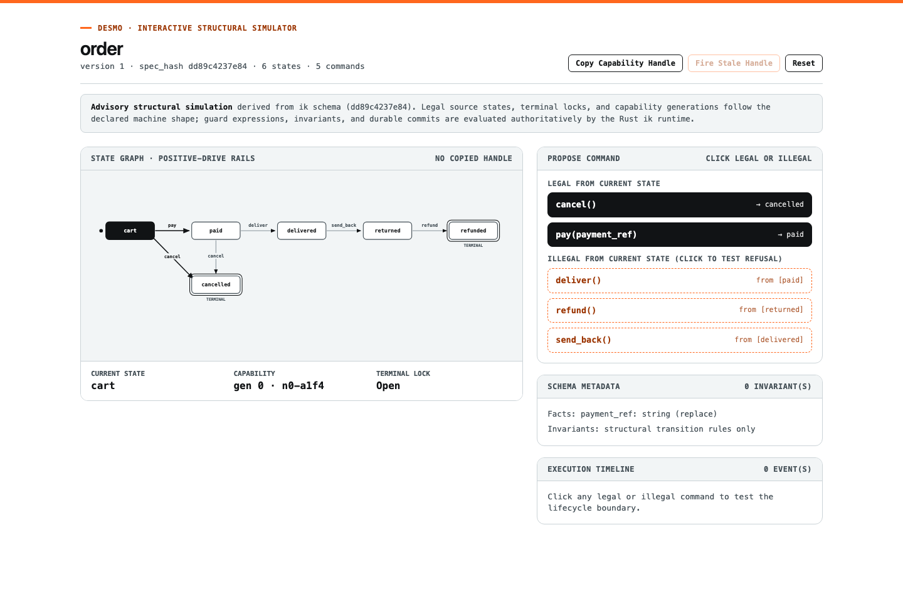

# Desmo

**Find hidden state bugs in 60s. Make illegal states impossible at runtime.**

> Your coding agent shipped one feature. Every test passed. Production didn't.

Run `SELECT DISTINCT status FROM orders;` on almost any app that has been shipped fast — or edited by coding agents — and you'll find `PAID`, `NULL`, unpaid carts refunded, cancelled orders delivered by a late worker, or a rogue status nobody remembers adding. Every PR passed its unit tests; the global lifecycle rules silently broke because nothing enforced them at runtime.

Desmo gives you two moves in one tool:

1. **Audit any existing repo in 60 seconds (read-only):** scan your codebase with Claude Code, Codex, or Cursor to find implicit state machines (`status` columns, boolean flag clusters, worker races) and open a zero-dependency interactive HTML simulator (`ik simulate`) to click illegal transitions yourself.
2. **Enforce critical lifecycles at runtime (no rewrite, zero Rust to write):** keep your app in TypeScript, Python, or Go. Define the rules once in a `.ik.toml` file — **the exact same file** `ik check` explores before deploy and `ik` (a single zero-dependency Rust + SQLite binary) enforces at runtime. Your code calls **commands** (`order.pay()`, `order.refund()`), never sets `status` directly, and every handle is version-checked so stale workers and late webhooks cannot overwrite newer state.

## Try it on your repo in 60 seconds (read-only)

Start read-only on your own codebase before adopting anything:

```bash
# 1. Install the `ik` CLI (macOS arm64 / Linux x86_64, SHA256SUMS-verified)
curl -fsSL https://raw.githubusercontent.com/GauravAlbal/desmo/main/install.sh | sh

# 2. Run the live runtime demos right away (zero Node/Python/Go required)
ik demo

# 3. Install the coding-agent skill (Claude Code, Codex, Cursor, or `skills` CLI)
npx skills add GauravAlbal/desmo
```

Or scaffold a runnable typed project directly in TypeScript, Python, or Go:

```bash
ik init order --lang ts   # or --lang py | --lang go
ik check desmo-order/order.ik.toml --summary
ik doctor --dir desmo-order
```

Then ask your coding agent:

> *"Find the implicit state machines in my app and check for state bugs."*

The skill stays strictly read-only ([skills/desmo/audit.md](skills/desmo/audit.md)): it maps every writer to your `status` columns or flag clusters, extracts a scratch `.ik.toml`, runs `ik diagram` + `ik check`, and emits a self-contained offline HTML simulator:

```bash
ik diagram examples/orders/order.ik.toml
ik simulate examples/orders/order.ik.toml --out order-simulator.html
```



Other tools stop at the diagram. When you find a lifecycle you actually want protected for good, switch to *"Enforce this lifecycle with Desmo"* ([skills/desmo/build.md](skills/desmo/build.md), `change.md`, `diagnose.md`, `readout.md`) — the exact `.ik.toml` you just checked and simulated becomes the runtime authority (single binary, zero Rust code to write).

*Other platforms can build `ik` from source: `cargo install --git https://github.com/GauravAlbal/desmo --tag v0.6.0 --bin ik`. Inside an existing Node project with `@desmo/runtime`, you can also install the skill via `npx --no-install desmo skill install --dir .`.*

## What a machine looks like

Define states, facts, commands, guards, effects, and invariants in one file ([examples/orders/order.ik.toml](examples/orders/order.ik.toml)):

```toml
schema_version = 1
machine_id = "order"
machine_version = 1

[facts]
payment_ref = { type = "string", policy = "replace" }

[states]
cart = { initial = true }
paid = {}
delivered = {}
returned = {}
refunded = { terminal = true }
cancelled = { terminal = true }

[commands.pay]
from = ["cart"]
to = "paid"
args = { payment_ref = "string" }
then = { payment_ref = "$payment_ref" }

[commands.deliver]
from = ["paid"]
to = "delivered"

[commands.cancel]
from = ["cart", "paid"]
to = "cancelled"

[commands.send_back]
from = ["delivered"]
to = "returned"

[commands.refund]
from = ["returned"]
to = "refunded"
```

Inspect it directly from the terminal (`ik diagram examples/orders/order.ik.toml`):

```text
6 states, 5 commands · 2 ends · every state reaches an end (structural) · shortest finish: 1 step · all rules declared
     ● [ cart ]                  ◀── YOU ARE HERE (1 step to end)
                                 ↗ pay → [ paid ]
         │
         │  cancel
         ▼
 ┌──▶✔ [ cancelled ]  END
 │ also reachable:
 │   ✔ [ refunded ]  END
 │   ○ [ paid ]
 └───────                        ↗ cancel → [ cancelled ]
                                 ↗ deliver → [ delivered ]
 ┌──▶○ [ returned ]
 │   ○ [ delivered ]
 └───────                        ↗ send_back → [ returned ]
```

```text
host (TypeScript / Python / Go)
        ↓ typed client (commands + versioned handles, never destination states)
ik      (single binary · canonical JSON · local SQLite)
        ↓
Desmo kernel  (same .ik.toml checked before deploy and enforced at runtime)
```

## 30-second runtime examples

### TypeScript / Node

Download the `0.6.0` runtime tarball and your platform tarball (`darwin-arm64` or `linux-x64`) from the [GitHub Release](https://github.com/GauravAlbal/desmo/releases/tag/v0.6.0) (no npm registry needed; the platform package bundles `ik`):

```bash
# macOS arm64 (for Linux x86_64, swap darwin-arm64 -> linux-x64)
curl -fsSLO https://github.com/GauravAlbal/desmo/releases/download/v0.6.0/desmo-runtime-0.6.0.tgz
curl -fsSLO https://github.com/GauravAlbal/desmo/releases/download/v0.6.0/desmo-darwin-arm64-0.6.0.tgz
npm install --no-audit --no-fund --ignore-scripts \
  ./desmo-runtime-0.6.0.tgz ./desmo-darwin-arm64-0.6.0.tgz

npx --no-install desmo demo orders        # unpaid refund & cancelled delivery refused
npx --no-install desmo demo stale-worker  # late worker refused with IK_CAPABILITY_STALE
npx --no-install desmo doctor --dir .
```

```ts
import { Kernel, IllegalStateError } from "@desmo/runtime";

const kernel = new Kernel(".state/orders.db"); // persistent `ik --session` enabled by default
const orders = await kernel.machine("examples/orders/order.ik.toml");

const order = await orders.create("order-1042");
await order.command("refund"); // throws IllegalStateError (IK_ILLEGAL_STATE) — stays in cart

const paid = await order.command("pay", { payment_ref: "ch_1042" });
console.log(paid.namedState(), paid.generation); // paid 1n
```

### Python

Install `ik` with the one-line installer above, then install the wheel directly from the GitHub Release:

```bash
pip install https://github.com/GauravAlbal/desmo/releases/download/v0.6.0/invariant_kernel-0.6.0-py3-none-any.whl
```

```python
from invariant_kernel import Kernel, IllegalStateError

orders = Kernel(store=".state/orders.db").machine("examples/orders/order.ik.toml")
order = orders.create("order-1042")

try:
    order.refund()
except IllegalStateError as err:
    print(err.code)  # IK_ILLEGAL_STATE — canonical state stays "cart"

paid = order.pay(payment_ref="ch_1042")
print(paid.state, paid.generation)  # paid 1
```

### Go

```go
// go get github.com/GauravAlbal/desmo/go@go/v0.6.0
k, _ := invariantkernel.Open(".state/orders.db", invariantkernel.Options{Session: true})
defer k.Close()
m, _ := k.Machine(ctx, "examples/orders/order.ik.toml")
order, _ := m.Create(ctx, "order-1042")
paid, _ := order.Command(ctx, "pay", map[string]any{"payment_ref": "ch_1042"})
```

## Core capabilities

- **Generation-bound capabilities:** every read/commit returns a versioned handle `(generation, nonce)`. A copied or stale handle attempting to mutate after a later commit is refused before a row mutates (`IK_CAPABILITY_STALE`).
- **Idempotent operation attribution:** callers attach an `operation_id` (or let the SDK generate one). On a dropped reply or timeout, `lookup_operation` distinguishes `committed_exact`, `conflict`, and `not_recorded` without silently retrying on a stale handle.
- **Bounded compound & parallel regions (schema 2):** author orthogonal regions, guarded child-first parent fallback, and atomic joint commands in `.ik.toml`, lowered to the same flat runtime engine ([docs/region-lowering.md](docs/region-lowering.md)).
- **Versioned machine evolution:** each aggregate pins `(machine_id, version, spec_hash)`. Deploy v2 for new aggregates while v1 aggregates drain cleanly on their original rules ([docs/machine-evolution.md](docs/machine-evolution.md)).
- **Python external reducers:** bind a deterministic `module:qualname` reducer for complex domain reduction while Rust retains sole authority over capabilities, transactions, journaling, replay, and declared kernel laws ([docs/python.md](docs/python.md)).
- **Unified typed codegen (TypeScript, Python, Go):** `ik codegen machine.ik.toml --lang ts|py|go --out <file>` generates typed `Machine`/`Aggregate` wrappers, `StateName` literals, and `Facts` directly from the compiled `.ik.toml` (`--check` fails if stale).
- **Effect-outcome guards & safe effect runners:** command guards can inspect `effect_status`, `effect_kind`, and `effect_outcome` (`when = "effect_status == 'recorded' && effect_outcome == 'succeeded'"`) so the kernel enforces outcome routing directly; TypeScript `runEffect`, Python `run_effect`, and Go `RunEffect` orchestrate plan → external execution with bound `idempotency_key` → outcome recording without blind duplicate execution.
- **Developer workbench:** `ik demo`, `ik init --lang ts|py|go`, `ik doctor`, `ik check` (with `--auto-seed`, `--summary`, `--compact`, zero-corpus structural lints, and automatic invariant-violation falsification), `ik laws`, `ik scenario run`, `ik diagram`, `ik simulate --open`, `ik codegen`, `ik handoff`, and `ik readout` run against the exact same transition engine.

## What's verified vs. what's open

Desmo does **not** claim to be "formally verified" end-to-end. Here is the exact boundary (full evidence and reproduction commands in [docs/assurance.md](docs/assurance.md)):

| Claim | Status | Boundary |
|---|---|---|
| Shared transition semantics (`ik check` = runtime) | **Implemented & tested** | Same `.ik.toml` AST/evaluator; does not stop host code from bypassing `ik`. |
| Core test suites (Rust / Python / TS / Go) | **Passing (`scripts/public-verify`)** | 700+ Rust, 160 Python, 83 TS, 45 Go tests on macOS arm64 & Linux x64. |
| Deleted-wall mutation controls | **15/15 kernel walls killed** | Deleting any of 15 core runtime walls fails tests; client transport layers not yet mutated. |
| Real process-crash recovery | **35+ crash tests** | Kills child processes (`SIGABRT` / `exit(86)`) across SQLite persistence & `after_operation` boundaries; trusts SQLite WAL & OS. |
| Multi-worker linearizability | **40 seeds × 3 workers** | Finite schedule check against a sequential reference model; not universal linearizability. |
| Dual-solver SMT / TLC / Hegel adapters | **Optional adapters** | `Z3 + cvc5` dual-solver feasibility, TLC 2.19 finite graph checks, Hegel sampling. |
| Kani bounded proofs (`src/runtime/authority.rs`) | **Verified (Kani 0.68 / CBMC 6.11)** | Exhaustive proofs over production payload-opaque `authorize_command` & `authorize_outcome_binding` gates (zero cutpoints, `<1s`, `8/8` cover properties each) + `validate_capability` ASCII nonces; concrete JSON/SHA-256 & SQLite remain outside Kani. |

## When to use Desmo (and when not to)

**Use it for:** canonical lifecycles with illegal transitions, approval gates, retries/exhaustion, external effects with idempotency keys, generation-bound authority, and crash-recoverable local SQLite state.

**Do not use it for:** stateless CRUD, routing, business calculations, multi-replica shared SQLite, read-only serverless filesystems, or distributed consensus.

## Naming & compatibility

- **Product & repo:** Desmo (`GauravAlbal/desmo`). **Engine & binary:** `invariant-kernel` / `ik`. **Machine files:** `.ik.toml`. **Node:** `@desmo/runtime`. **Python:** `invariant_kernel`. **Go:** `github.com/GauravAlbal/desmo/go`.
- The name comes from a *desmodromic valve*, driven positively in both directions by cam tracks instead of relying on a spring to close.
- **Protocol `1.0` · Runtime `0.6.0` · Store schema `4`.** `ik` and your language client must match runtime versions exactly. Existing `ikaros.trace.v2` schema identifiers remain unchanged for bundle compatibility.

## Documentation

- [Assurance & verification boundaries](docs/assurance.md)
- [Order lifecycle example](examples/orders/README.md) · [Publish-approval example](examples/publish-approval/README.md) · [Job retrofit example](docs/examples/retrofit-job/README.md)
- [Machine language (`.ik.toml`)](docs/machine-language.md) · [Region lowering (schema 2)](docs/region-lowering.md)
- [TypeScript](docs/typescript.md) · [Python](docs/python.md) · [Go](docs/go.md)
- [Greenfield guide](docs/greenfield.md) · [Brownfield migration](docs/brownfield-migration.md) · [Patterns](docs/patterns.md)
- [Agent guide](docs/agent.md) · [Coding-agent skill](skills/desmo/SKILL.md)
- [`ik check`](docs/ik-check.md) · [Scenarios](docs/scenarios.md) · [Workbench report](docs/workbench-report.md) · [Diagnostics](docs/diagnostics.md)
- [Machine evolution](docs/machine-evolution.md) · [Client recovery](docs/client-recovery.md) · [Operation identity](docs/operation-identity.md)
- [Upgrading & pins](docs/upgrading.md) · [Release compatibility](docs/release-compatibility.md) · [Security](SECURITY.md)

## License

Dual-licensed under [MIT](LICENSE-MIT) or [Apache-2.0](LICENSE-APACHE).
