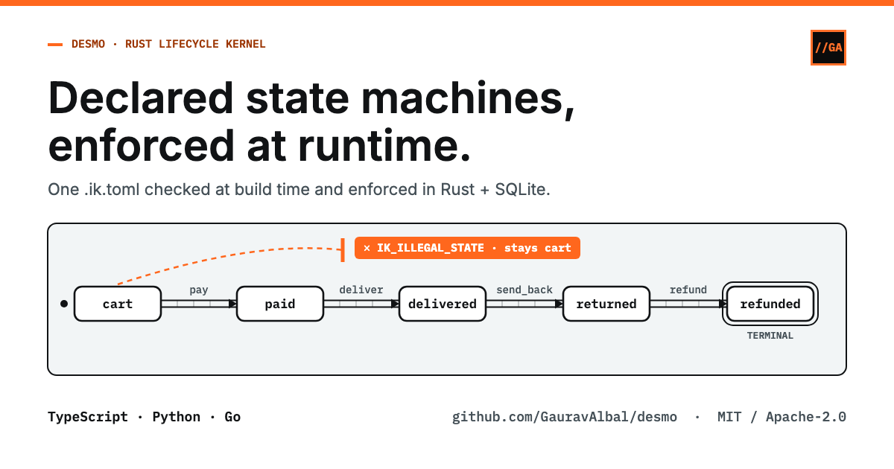

<div align="center">
  
</div>

<p align="center">
  <strong>Find hidden state bugs in 60s. Make illegal states impossible at runtime.</strong><br/>
  Single zero-dependency Rust + SQLite binary (<code>ik</code>) for TypeScript, Python, and Go.
</p>

<p align="center">
  <a href="https://github.com/GauravAlbal/desmo/actions/workflows/ci.yml"></a>
  <a href="https://github.com/GauravAlbal/desmo/releases/tag/v0.7.0"></a>
  <a href="LICENSE-MIT"></a>
  
</p>

<p align="center">
  <a href="#try-it-in-60-seconds">60s Audit</a> &bull;
  <a href="#how-it-works">How It Works</a> &bull;
  <a href="#use-it-in-typescript-python-or-go">SDKs</a> &bull;
  <a href="#assurance--explicit-non-goals">Assurance &amp; Non-Goals</a> &bull;
  <a href="#documentation">Docs</a>
</p>

---

## Try it in 60 seconds

**1. Install `ik` and run the live runtime demos** (zero Node, Python, or Go required):

```bash
curl -fsSL https://raw.githubusercontent.com/GauravAlbal/desmo/main/install.sh | sh
ik demo
```

```text
  refund(cart)       -> refused (IK_ILLEGAL_STATE) · stays cart
  deliver(cancelled) -> refused (IK_ILLEGAL_STATE) · stays cancelled
  pay->deliver->send_back->refund -> committed (refunded, gen 4)
  refund(refunded)   -> refused (IK_ILLEGAL_STATE) · terminal lock holds
  Worker A starts (gen 1), Worker B cancels (gen 2, cancelled)
  Late Worker A submit(gen 1) -> refused (IK_CAPABILITY_STALE) · canonical state stays cancelled (gen 2)
```

**2. Audit your existing repo read-only** with Claude Code, Codex, or Cursor:

```bash
npx skills add GauravAlbal/desmo
```

> *"Find the implicit state machines in my app and check for state bugs."*

It stays strictly read-only ([`skills/desmo/audit.md`](skills/desmo/audit.md)): maps every writer to `status` columns or boolean flags, extracts a scratch `.ik.toml`, runs `ik diagram` + `ik check --auto-seed --summary`, and opens an offline interactive HTML simulator (`ik simulate`).


## How it works

<div align="center">
  
</div>

Define states, facts, commands, guards, effects, and invariants once in `.ik.toml` — the exact same file you check before deploy (`ik check`) and simulate (`ik simulate`) is enforced at runtime by `ik` + local SQLite ([`examples/orders/order.ik.toml`](examples/orders/order.ik.toml)):

```toml
schema_version = 1
machine_id = "order"
machine_version = 1

[facts]
payment_ref = { type = "string", policy = "replace" }

[states]
cart = { initial = true }
paid = {}
delivered = {}
returned = {}
refunded = { terminal = true }
cancelled = { terminal = true }

[commands.pay]
from = ["cart"]
to = "paid"
args = { payment_ref = "string" }
then = { payment_ref = "$payment_ref" }

[commands.deliver]
from = ["paid"]
to = "delivered"

[commands.cancel]
from = ["cart", "paid"]
to = "cancelled"

[commands.send_back]
from = ["delivered"]
to = "returned"

[commands.refund]
from = ["returned"]
to = "refunded"
```

```bash
ik diagram examples/orders/order.ik.toml
ik check examples/orders/order.ik.toml --auto-seed --summary
ik simulate examples/orders/order.ik.toml --open
```

## Highlights

- **What you check is what runs:** `ik check` and runtime commits execute the same declarative AST and evaluator, catching `policy = "once"`, invariant violations (`IK_INVARIANT_FAILED`), and structural dead ends before deploy.
- **Stale-worker & race fencing:** Every read/commit returns a versioned handle `(generation, nonce)` so late workers and stale webhooks refuse cleanly (`IK_CAPABILITY_STALE`) before a row mutates.
- **Crash-safe external effects:** Command guards inspect `effect_status`, `effect_kind`, and `effect_outcome`; `runEffect` / `run_effect` / `RunEffect` orchestrate plan → side effect with bound `idempotency_key` → outcome recording.
- **Zero-boilerplate SDKs & codegen:** Scaffold projects with `ik init order --lang ts|py|go` or emit typed wrappers with `ik codegen --lang ts|py|go`, plus [`schema/ik.schema.json`](schema/ik.schema.json) for editor validation.
- **Brownfield & ops ready:** Query materialized aggregates via indexed `ik list` / `machine.list(...)`, stream ordered events via `kernel.events()`, block direct DB writes in CI via `ik guard`, and verify stores read-only via `ik store verify`.
- **Measured single-binary SQLite throughput:** `WAL + PRAGMA synchronous=FULL` default delivers **3,495 commits/s** (`p50=0.23ms`, `p99=1.13ms`) on Apple Silicon; indexed `ik list` at 5k aggregates runs in **`p50=5.27ms`** ([`scripts/bench.py`](scripts/bench.py)).

## Use it in TypeScript, Python, or Go

Scaffold a runnable typed project in one command:

```bash
ik init order --lang ts   # or --lang py | --lang go
```

**TypeScript / Node**

```ts
import { Kernel } from "@desmo/runtime";

const kernel = new Kernel(".state/orders.db"); // persistent `ik --session` enabled by default
const orders = await kernel.machine("examples/orders/order.ik.toml");
const order = await orders.create("order-1042");
await order.command("refund"); // throws IllegalStateError (IK_ILLEGAL_STATE) — stays in cart
const paid = await order.command("pay", { payment_ref: "ch_1042" });
```

**Python**

```python
from invariant_kernel import Kernel

with Kernel(store=".state/orders.db", session=True) as kernel:
    orders = kernel.machine("examples/orders/order.ik.toml")
    order = orders.create("order-1042")
    order.pay(payment_ref="ch_1042") # illegal commands raise IllegalStateError
```

**Go**

```go
k, _ := invariantkernel.Open(".state/orders.db", invariantkernel.Options{Session: true})
defer k.Close()
m, _ := k.Machine(ctx, "examples/orders/order.ik.toml")
order, _ := m.Create(ctx, "order-1042")
paid, _ := order.Command(ctx, "pay", map[string]any{"payment_ref": "ch_1042"})
```

<details>
<summary>Manual SDK installation (v0.7.0)</summary>

- **TypeScript / Node** (macOS arm64; swap `darwin-arm64` → `linux-x64` for Linux x86_64):
  ```bash
  curl -fsSLO https://github.com/GauravAlbal/desmo/releases/download/v0.7.0/desmo-runtime-0.7.0.tgz
  curl -fsSLO https://github.com/GauravAlbal/desmo/releases/download/v0.7.0/desmo-darwin-arm64-0.7.0.tgz
  npm install --no-audit --no-fund --ignore-scripts ./desmo-runtime-0.7.0.tgz ./desmo-darwin-arm64-0.7.0.tgz
  ```
- **Python** (requires `ik` installed):
  ```bash
  pip install https://github.com/GauravAlbal/desmo/releases/download/v0.7.0/invariant_kernel-0.7.0-py3-none-any.whl
  ```
- **Go**:
  ```bash
  go get github.com/GauravAlbal/desmo/go@go/v0.7.0
  ```
- **Build `ik` from source**: `cargo install --git https://github.com/GauravAlbal/desmo --tag v0.7.0 --bin ik`

</details>

## Assurance & explicit non-goals

Desmo does **not** claim to be "formally verified" end-to-end. Full evidence and reproduction commands live in [`docs/assurance.md`](docs/assurance.md):

| Layer | Verified in CI | Explicit boundary |
|---|---|---|
| Shared semantics & test suites | 700+ Rust, 160+ Py, 84+ TS, 45+ Go tests (`scripts/public-verify`) | Same `.ik.toml` AST/evaluator; finite test corpus, not universal proof. |
| Deleted-wall mutation suites | **15/15 kernel + 6/6 SDK walls killed** | Deleting constitutional runtime or TS/Py/Go transport guards fails CI. |
| Crash recovery & concurrency | **35+ `SIGABRT`/`exit(86)` tests + 40×3 linearizability** | Finite schedule sampling; trusts SQLite WAL & local OS. |
| Bounded formal & SMT/TLC | **5 CI Kani 0.68 harnesses** + optional Z3/cvc5 & TLC 2.19 | Concrete JSON/SHA-256 serialization & SQLite remain outside Kani. |
| SQLite durability & perf | **3,495 commits/s** (`WAL + synchronous=FULL`), `ik list` `p50=5.27ms` | Measured on Apple Silicon macOS (`scripts/bench.py`). |

### What Desmo intentionally does NOT do

1. **No unbounded inductive proofs or guarded deadlock-freedom proofs:** `ik check` runs bounded corpus exploration + optional SMT unreachability, not k-induction or unbounded liveness proofs; unexplored invariant violations refuse at runtime with `IK_INVARIANT_FAILED`.
2. **No cross-aggregate atomic invariants or distributed consensus:** Each transaction enforces invariants on one `aggregate_id` in local SQLite (no cross-account conservation or Raft/Paxos consensus).
3. **No multi-replica shared SQLite or `ik serve` network daemon in `0.7.0`:** Stores are single-node local SQLite; use Track 1 audit or single-writer projection (`kernel.events()`) for multi-container web apps.
4. **No cryptographic caller authentication on capability tokens:** `(generation, nonce)` is deterministic optimistic-concurrency staleness fencing, not a secret against untrusted callers.
5. **No automatic historical-state schema migrator:** Aggregates pin `(machine_id, version, spec_hash)` strictly; deploy new versions for new aggregates while older ones drain.
6. **No whole-program static anti-bypass proof:** `ik guard` scans configured source paths for status-table writes rather than proving full-program dataflow isolation.
7. **No exactly-once external side effects:** External effects are at-least-once with kernel-bound `idempotency_key` attribution; downstream sinks must honor the key.
8. **No OS sandbox for external Python reducers:** `kernel.reducer` is a cooperative deterministic-reducer contract, not an isolation sandbox.
9. **No npm or PyPI registry packages in `0.7.0`:** Node tarballs and Python wheels ship directly on GitHub Releases with `SHA256SUMS`; Go installs via `go/v0.7.0`.

## Documentation

- **Core:** [Assurance & verification](docs/assurance.md) · [Machine language (`.ik.toml`)](docs/machine-language.md) · [Region lowering (schema 2)](docs/region-lowering.md) · [`ik check`](docs/ik-check.md) · [Diagnostics](docs/diagnostics.md)
- **SDKs & examples:** [TypeScript](docs/typescript.md) · [Python](docs/python.md) · [Go](docs/go.md) · [Orders](examples/orders/README.md) · [Publish approval](examples/publish-approval/README.md) · [Job retrofit](docs/examples/retrofit-job/README.md)
- **Architecture & ops:** [Greenfield](docs/greenfield.md) · [Brownfield](docs/brownfield-migration.md) · [Patterns](docs/patterns.md) · [Evolution](docs/machine-evolution.md) · [Recovery](docs/client-recovery.md) · [Operation identity](docs/operation-identity.md) · [Scenarios](docs/scenarios.md) · [Workbench](docs/workbench-report.md)
- **Agents & releases:** [Agent guide](docs/agent.md) · [Coding-agent skill](skills/desmo/SKILL.md) · [Upgrading](docs/upgrading.md) · [Compatibility](docs/release-compatibility.md) · [Security](SECURITY.md)

---

**Protocol `1.0` · Runtime `0.7.0` · Store schema `4`** (`ikaros.trace.v2` wire compatibility preserved). Named after the *desmodromic valve*, driven positively in both directions by cam tracks. Dual-licensed under [MIT](LICENSE-MIT) or [Apache-2.0](LICENSE-APACHE).
