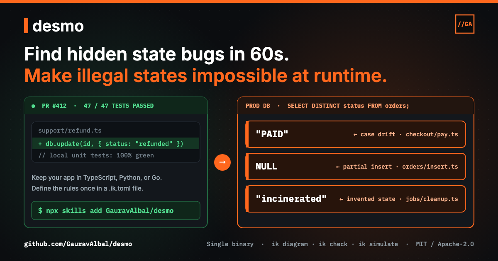

<div align="center">
  
</div>

<p align="center">
  Single-binary Rust + SQLite state-machine kernel (<code>ik</code>) for TypeScript, Python, and Go.<br/>
  Audit implicit lifecycles read-only in 60s &mdash; or enforce them at runtime with zero Rust to write.
</p>

<p align="center">
  <a href="https://github.com/GauravAlbal/desmo/actions/workflows/ci.yml"></a>
  <a href="https://github.com/GauravAlbal/desmo/releases/tag/v0.7.1"></a>
  <a href="LICENSE-MIT"></a>
  
</p>

<p align="center">
  <a href="#try-it-in-60-seconds">60s Audit</a> &bull;
  <a href="#why-desmo">Why Desmo</a> &bull;
  <a href="#how-it-works">How It Works</a> &bull;
  <a href="#use-it-in-typescript-python-or-go">SDKs</a> &bull;
  <a href="#assurance--explicit-non-goals">Assurance &amp; Non-Goals</a>
</p>

---

## Try it in 60 seconds

**Option A — Paste this to your coding agent** (Claude Code, Codex, Cursor):

```text
Install Desmo (`curl -fsSL https://raw.githubusercontent.com/GauravAlbal/desmo/main/install.sh | sh` and `npx skills add GauravAlbal/desmo`), then follow the Desmo skill in read-only audit mode: find the highest-risk implicit state machines in this repo, extract a scratch `.ik.toml`, run `ik check --auto-seed --summary`, and generate an interactive HTML simulator with `ik simulate`. Don't edit any repo files until I pick a lifecycle to enforce.
```

Your agent stays strictly read-only ([`skills/desmo/audit.md`](skills/desmo/audit.md)), maps every `status`/flag writer with `file:line` coordinates, and hands you one self-contained offline HTML simulator (`ik simulate --check`) with checked properties, 1-click **Replay Bug** traces, and **Delta / Full** step scrubbing.

**Option B — Run the 10-second live demo yourself** (zero Node, Python, or Go required):

```bash
curl -fsSL https://raw.githubusercontent.com/GauravAlbal/desmo/main/install.sh | sh
ik demo
```

```text
# orders (order.ik.toml)
  refund(cart)       -> refused (IK_ILLEGAL_STATE) · stays cart
  deliver(cancelled) -> refused (IK_ILLEGAL_STATE) · stays cancelled
  pay->deliver->send_back->refund -> committed (refunded, gen 4)
  refund(refunded)   -> refused (IK_ILLEGAL_STATE) · terminal lock holds

# stale-worker (verification_attempt.ik.toml)
  Worker A starts (gen 1), Worker B cancels (gen 2, cancelled)
  Late Worker A submit(gen 1) -> refused (IK_CAPABILITY_STALE) · canonical state stays cancelled (gen 2)
```


## Why Desmo

- **What you check is what runs:** `ik check` and runtime commits execute the same declarative AST and evaluator — supporting inline `[reach]` properties, `--bound` bounded counter domains, deterministic seeded deep simulation (`--simulate --seed`), parallel BFS (`--threads`, `--fail-fast`), runnable `--emit-scenario` repros, and 1-click counterexample replay inside offline `ik simulate` HTML.
- **Stale-worker & race fencing:** Every read and commit returns a `(generation, nonce)` capability handle so late workers and stale webhooks refuse (`IK_CAPABILITY_STALE`) before any row mutates.
- **Crash-safe external effects:** Guards inspect `effect_status`, `effect_kind`, and `effect_outcome`; `runEffect` / `run_effect` / `RunEffect` bind `idempotency_key` before running side effects and recording outcomes.
- **Zero-ops local SQLite throughput:** `WAL + PRAGMA synchronous=FULL` default delivers **3,495 commits/s** (`p50=0.23ms`, `p99=1.13ms`) on Apple Silicon; indexed `ik list` at 5k aggregates runs in **`p50=5.27ms`** ([`scripts/bench.py`](scripts/bench.py)), with read-only whole-store verification via `ik store verify`.
- **Brownfield Postgres & multi-language compatible:** Stream committed events out to Postgres (`kernel.events()`), block direct `status` writes in CI (`ik guard`), and emit typed TS/Py/Go wrappers (`ik codegen` + [`schema/ik.schema.json`](schema/ik.schema.json)).

## How it works

Declare states, facts, commands, guards, and invariants once in `.ik.toml` ([`examples/orders/order.ik.toml`](examples/orders/order.ik.toml)) — check it in CI, simulate it in HTML, and enforce it at runtime:

```toml
schema_version = 1
machine_id = "order"
machine_version = 1

[facts]
payment_ref = { type = "string", policy = "replace" }

[states]
cart = { initial = true }
paid = {}
delivered = {}
returned = {}
refunded = { terminal = true }
cancelled = { terminal = true }

[commands.pay]
from = ["cart"]
to = "paid"
args = { payment_ref = "string" }
then = { payment_ref = "$payment_ref" }

[commands.deliver]
from = ["paid"]
to = "delivered"

[commands.cancel]
from = ["cart", "paid"]
to = "cancelled"

[commands.send_back]
from = ["delivered"]
to = "returned"

[commands.refund]
from = ["returned"]
to = "refunded"
```

```bash
ik check examples/orders/order.ik.toml --auto-seed --summary
# Optional: --bound "retries <= 5" --simulate --seed 42 --emit-scenario repro.json
ik simulate examples/orders/order.ik.toml --check --open
```

## Use it in TypeScript, Python, or Go

Scaffold a runnable typed starter in one command: `ik init order --lang ts` (or `--lang py` | `--lang go`).

**TypeScript / Node**

```ts
import { Kernel } from "@desmo/runtime";
const orders = await new Kernel(".state/orders.db").machine("examples/orders/order.ik.toml");
const order = await orders.create("order-1042");
await order.command("refund"); // throws IllegalStateError (IK_ILLEGAL_STATE) — stays cart
const paid = await order.command("pay", { payment_ref: "ch_1042" }); // committed: paid (gen 1)
```

**Python**

```python
from invariant_kernel import Kernel
with Kernel(store=".state/orders.db", session=True) as kernel:
    order = kernel.machine("examples/orders/order.ik.toml").create("order-1042")
    order.refund()                    # raises IllegalStateError (IK_ILLEGAL_STATE) — stays cart
    paid = order.pay(payment_ref="ch_1042")  # committed: paid (gen 1)
```

**Go**

```go
k, _ := invariantkernel.Open(".state/orders.db", invariantkernel.Options{Session: true})
defer k.Close()
m, _ := k.Machine(ctx, "examples/orders/order.ik.toml")
order, _ := m.Create(ctx, "order-1042")
_, _ = order.Command(ctx, "refund", nil)                              // returns IK_ILLEGAL_STATE — stays cart
paid, _ := order.Command(ctx, "pay", map[string]any{"payment_ref": "ch_1042"}) // committed: paid (gen 1)
```

<details>
<summary>Manual SDK install from GitHub Releases v0.7.1 (not yet on npm / PyPI)</summary>

- **TypeScript / Node** (macOS arm64; swap `darwin-arm64` → `linux-x64` for Linux x86_64):
  ```bash
  curl -fsSLO https://github.com/GauravAlbal/desmo/releases/download/v0.7.1/desmo-runtime-0.7.1.tgz
  curl -fsSLO https://github.com/GauravAlbal/desmo/releases/download/v0.7.1/desmo-darwin-arm64-0.7.1.tgz
  npm install --no-audit --no-fund --ignore-scripts ./desmo-runtime-0.7.1.tgz ./desmo-darwin-arm64-0.7.1.tgz
  ```
- **Python** (requires `ik` installed): `pip install https://github.com/GauravAlbal/desmo/releases/download/v0.7.1/invariant_kernel-0.7.1-py3-none-any.whl`
- **Go**: `go get github.com/GauravAlbal/desmo/go@go/v0.7.1`
- **From source**: `cargo install --git https://github.com/GauravAlbal/desmo --tag v0.7.1 --bin ik`

</details>

## Assurance & explicit non-goals

Desmo does **not** claim to be "formally verified" end-to-end ([`docs/assurance.md`](docs/assurance.md)):

| Layer | Verified in CI | Explicit boundary |
|---|---|---|
| Shared semantics & test suites | 700+ Rust, 160+ Python, 86 TS, 45+ Go tests (`scripts/public-verify`) | `ik guard` catches configured bypass writes in CI; not a full-program proof. |
| Deleted-wall mutation suites | **15/15 kernel + 6/6 SDK walls killed** | Deleting constitutional runtime or TS/Py/Go transport guards fails CI. |
| Crash recovery & concurrency | **35+ `SIGABRT`/`exit(86)` tests + 40×3 linearizability** | Finite schedule sampling; trusts SQLite WAL & local OS. |
| Bounded formal & SMT/TLC | **5 CI Kani 0.68 harnesses** + optional Z3/cvc5 & TLC 2.19 | Concrete JSON/SHA-256 serialization & SQLite remain outside Kani. |
| SQLite durability & perf | **3,495 commits/s** (`WAL + synchronous=FULL`), `ik list` `p50=5.27ms` | Measured on Apple Silicon macOS (`scripts/bench.py`). |

### What Desmo intentionally does NOT do

1. **No unbounded inductive proofs or guarded deadlock-freedom proofs:** `ik check` runs bounded corpus BFS (with optional `--bound` domain pruning, deterministic seeded deep simulation `--simulate`, and optional SMT unreachability) rather than k-induction or unbounded liveness proofs; unexplored invariant violations refuse at runtime (`IK_INVARIANT_FAILED`).
2. **No cross-aggregate atomic invariants or distributed consensus:** Each transaction enforces invariants on one `aggregate_id` in local SQLite (no cross-account conservation or Raft/Paxos consensus).
3. **No multi-replica shared SQLite or `ik serve` network daemon in `0.7.1`:** Stores are single-node local SQLite; use read-only audit or single-writer projection (`kernel.events()`) for multi-container web apps.
4. **No cryptographic caller authentication on capability tokens:** `(generation, nonce)` is deterministic optimistic-concurrency staleness fencing, not a secret against untrusted callers.
5. **No automatic historical-state schema migrator:** Aggregates pin `(machine_id, version, spec_hash)` strictly; deploy new versions for new aggregates while older ones drain.
6. **No whole-program static anti-bypass proof:** `ik guard` scans configured source paths for status-table writes rather than proving full-program dataflow isolation.
7. **No exactly-once external side effects:** External effects are at-least-once with kernel-bound `idempotency_key` attribution; downstream sinks must honor the key.
8. **No OS sandbox for external Python reducers:** `kernel.reducer` is a cooperative deterministic-reducer contract, not an isolation sandbox.
9. **No npm or PyPI registry packages in `0.7.1`:** Node tarballs and Python wheels ship directly on GitHub Releases with `SHA256SUMS`; Go installs via `go/v0.7.1`.

## Documentation

[Assurance](docs/assurance.md) · [Machine language](docs/machine-language.md) · [Region lowering](docs/region-lowering.md) · [`ik check`](docs/ik-check.md) · [TypeScript](docs/typescript.md) · [Python](docs/python.md) · [Go](docs/go.md) · [Brownfield](docs/brownfield-migration.md) · [Evolution](docs/machine-evolution.md) · [Recovery](docs/client-recovery.md) · [Patterns](docs/patterns.md) · [Agent skill](skills/desmo/SKILL.md) · [Diagnostics](docs/diagnostics.md) · [Security](SECURITY.md)

---

**Protocol `1.0` · Runtime `0.7.1` · Store schema `4`** (`ikaros.trace.v2` wire compatibility preserved). Named after the *desmodromic valve*. Dual-licensed under [MIT](LICENSE-MIT) or [Apache-2.0](LICENSE-APACHE).
